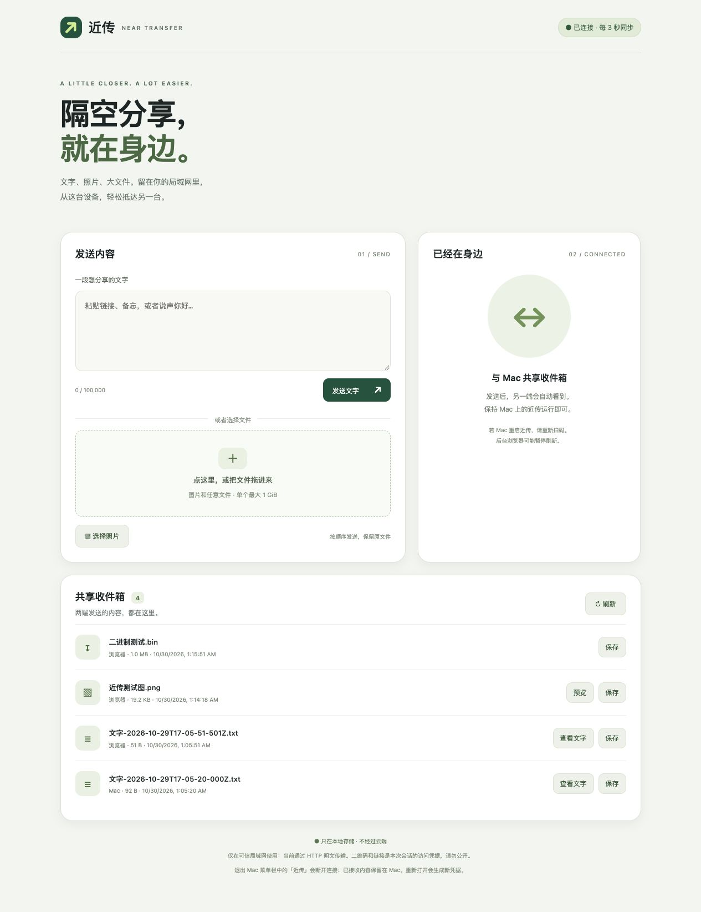
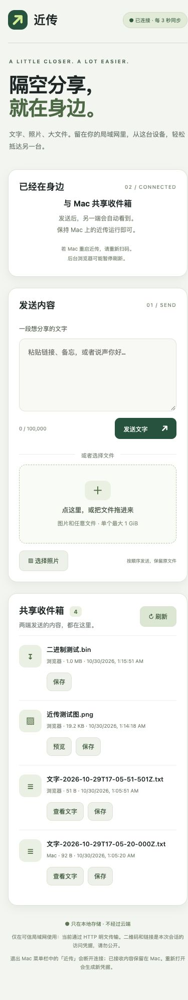

# NearTransfer

**Share text, photos, and files across your local network.**

NearTransfer is a native macOS app that opens a local web interface. Scan its QR code on another device to share in both directions using a browser. No account, cloud service, or Android app required.

[Download for macOS](https://github.com/CauT/neartransfer/releases/tag/v0.1.0) · [简体中文](README.zh-CN.md)

## Screenshots

### Desktop browser



### Mobile layout



The interface currently uses Chinese. The mobile screenshot shows a responsive browser layout.

## Install and share

Requires **Apple Silicon (arm64), macOS 13 or later**.

1. Download the **DMG** from [Releases](https://github.com/CauT/neartransfer/releases/tag/v0.1.0), open it, and drag **NearTransfer.app** into **Applications**. A ZIP download is also available.
2. Open NearTransfer. It launches the local service and opens the sharing page in your default browser.
3. Connect your phone or other computer to the same Wi-Fi/LAN. Scan the QR code or open the connection link shown on the Mac page.
4. Send text, choose photos or files, or drag files onto the page. Both devices share an inbox that refreshes every three seconds. Preview images, copy text, or save original files.
5. Keep the Mac app running. Quit it from its window or menu bar to stop sharing. Relaunching preserves received items and creates new pairing credentials.

This is an **ad-hoc signed development preview**, without Developer ID signing or Apple notarization.

## Features

- Bidirectional text, image, and file sharing through a browser.
- Multiple file uploads with progress and cancellation.
- Original file bytes and names; uploads with identical names do not overwrite each other.
- Up to **1 GiB per file**, **1,000 inbox items**, and **4 concurrent uploads**.
- Text preview up to 1 MiB; supported image previews up to 20 MiB.
- Local storage only, with fresh 256-bit pairing credentials on each launch.
- No runtime dependencies or external web assets.

## Privacy and compatibility

Transfers use **unencrypted HTTP**. Use a trusted LAN. The QR code/link grants read and write access to the entire current inbox; keep it private. The app does not change your proxy, VPN, firewall, routes, or certificate trust.

Received items stay in `~/Library/Application Support/NearTransfer/Inbox/`. Quit the app before moving the complete inbox directory for archiving. Individual item deletion and resumable uploads are not currently supported.

Wi-Fi client isolation and Mac firewall rules can prevent connections. Choose another network address on the pairing page when needed. Keep mobile pages in the foreground during transfers.

Safari image and binary downloads have been verified against the original SHA-256 hashes. The automated Chrome environment reported `ERR_BLOCKED_BY_CLIENT`; physical phone pairing and saving have not been verified. See the [acceptance record](docs/acceptance.md) for details.

## Build from source

Requires Go 1.24+, Xcode Command Line Tools / Swift, and macOS. Node and Python are used by the optional checks below. The packaged app does not require these tools.

```sh
bash scripts/build.sh
# Output: build/NearTransfer.app

(cd engine && go test -race ./... && go vet ./...)
node --check engine/web/app.js
python3 scripts/check-lifecycle.py
bash scripts/package.sh
```

The Go standard library server embeds the web UI. Swift AppKit provides the launcher and menu bar; CoreImage generates pairing QR codes. The engine exits on stdin EOF or SIGTERM, and a storage lock prevents simultaneous writers.

## License

[MIT](LICENSE)
